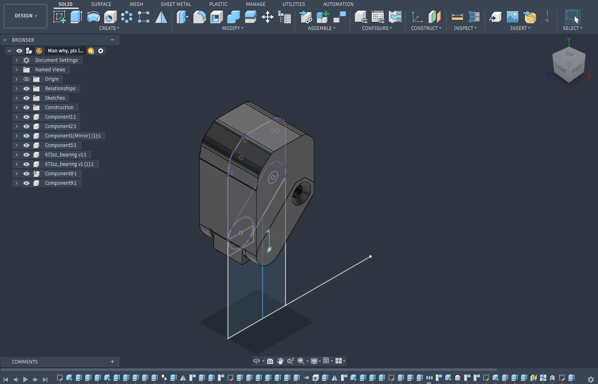

# Dexterous Hand Design & Building Journal
* All progression and what I have done will be written in here
* **NOTE:** I will not share or leak any images, cad files that I have done in the following days till it is fully ready
**The images that was shown in readme are old and just used for testing how dexterous hand works**

**Total Time Logged:** 21h

**Software:** Autodesk Fusion  

## Entry 8 — November 25, 2026
* **Time Spent:** 6h
* **What I Worked On:**
  * Printed out prototype of fingers with Ender 3 Pro
  * Finger was too long and is not realistic
  * Remodified the finger and added more details to the finger
  * Found out that finger joints could still be improved
* **Screenshot:**
  [WILL UPLOAD PROGRESS OF TODAY SESSION ONCE DEX HAND IS FULLY COMPLETED]

## November 24,2026
* Doing printer calibration and upscale it😭

## Entry 7 — November 23, 2026
* **Time Spent:** 1hr
* **What I Worked On:**
  * Fixed 3d printer issue and upgraded fan duct as well calibrating my Ender 3 Pro (Took almost whole day)
  * Redo hole dimension to attach tendon wires
* **Screenshot:**
  [WILL UPLOAD PROGRESS OF TODAY SESSION ONCE DEX HAND IS FULLY COMPLETED]

## Entry 6 — November 22, 2026
* **Time Spent:** 30mins
* **What I Worked On:**
  * Chamfered heat insert holes and edited tunnel because of 3d printer accuracy issue
* **Screenshot:**
  [WILL UPLOAD PROGRESS OF TODAY SESSION ONCE DEX HAND IS FULLY COMPLETED]

---
## Entry 5 — November 20, 2026
* **Time Spent:** 30mins
* **What I Worked On:**
  * Redesigned locks between joints
* **Screenshot:**
  [WILL UPLOAD PROGRESS OF TODAY SESSION ONCE DEX HAND IS FULLY COMPLETED]

---
## Entry 4 — November 18, 2026
* **Time Spent:** 5h
* **What I Worked On:**
  * Worked on the latest finger design
  * Worked on the tunnel path
  * Built the finger visual touch
  * Found a few errors and will work on it tomorrow
* **Screenshot:**
  [WILL UPLOAD PROGRESS OF TODAY SESSION ONCE DEX HAND IS FULLY COMPLETED]

---
## Entry 3 — November 17, 2026
* **Time Spent:** 2h
* **What I Worked On:**
# PREVIOUS DESIGN WHICH WWAS SHOWN BELOW IS JUST A CONCEPT AND WONT BE USED ANYMORE
  * Redesigned the joints and mechanism as the previous ones seems to not work for the best.
* **Screenshot:**
  [WILL UPLOAD PROGRESS OF TODAY SESSION ONCE DEX HAND IS FULLY COMPLETED]

---
## Entry 2 — November 16, 2026
* **Time Spent:** 4h
* **What I Worked On:**
  * Backlit tunnel does not function properly after 3D printing
  * Redesign the finger joint but still in progress
* **Screenshot:**
  

---

## Entry 1 — November 15, 2026
* **Time Spent:** 2h
* **What I Worked On:**
  * Created top finger sketch and for the shape of it
  * Added internal bearings and components
* **Screenshot:**
  
