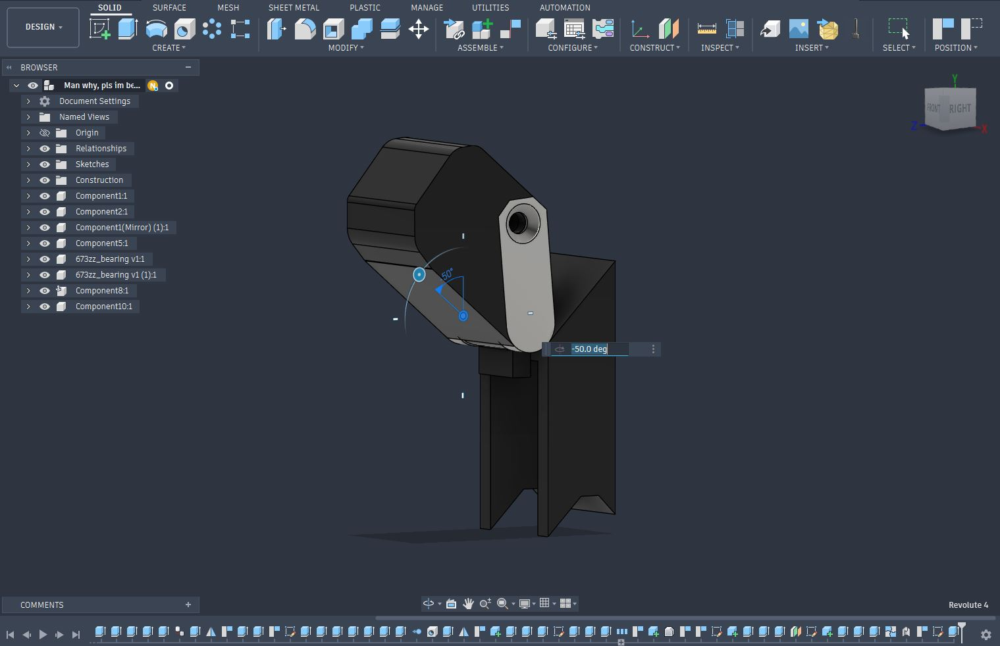

# Project Name — CAD Design Journal (New design wont be leaked here until the dexterous hand is fully completed)

**Total Time Logged:** 13h
**Software:** Autodesk Fusion  

---
## Entry 5 — November 20, 2026
* **Time Spent:** 30mins
* **What I Worked On:**
  * Redesigned locks between joints
* **Screenshot:**
  [WILL UPLOAD PROGRESS OF TODAY SESSION ONCE DEX HAND IS FULLY COMPLETED]

---
## Entry 4 — November 18, 2026
* **Time Spent:** 5h
* **What I Worked On:**
  * Worked on the latest finger design
  * Worked on the tunnel path
  * Built the finger visual touch
  * Found a few errors and will work on it tomorrow
* **Screenshot:**
  [WILL UPLOAD PROGRESS OF TODAY SESSION ONCE DEX HAND IS FULLY COMPLETED]

---
## Entry 3 — November 17, 2026
* **Time Spent:** 2h
* **What I Worked On:**
# PREVIOUS DESIGN WHICH WWAS SHOWN BELOW IS JUST A CONCEPT AND WONT BE USED ANYMORE
  * Redesigned the joints and mechanism as the previous ones seems to not work for the best.
* **Screenshot:**
  [WILL UPLOAD PROGRESS OF TODAY SESSION ONCE DEX HAND IS FULLY COMPLETED]

---
## Entry 2 — November 16, 2026
* **Time Spent:** 4h
* **What I Worked On:**
  * Backlit tunnel does not function properly after 3D printing
  * Redesign the finger joint but still in progress
* **Screenshot:**
  

---

## Entry 1 — November 15, 2026
* **Time Spent:** 2h
* **What I Worked On:**
  * Created top finger sketch and for the shape of it
  * Added internal bearings and components
* **Screenshot:**
  
