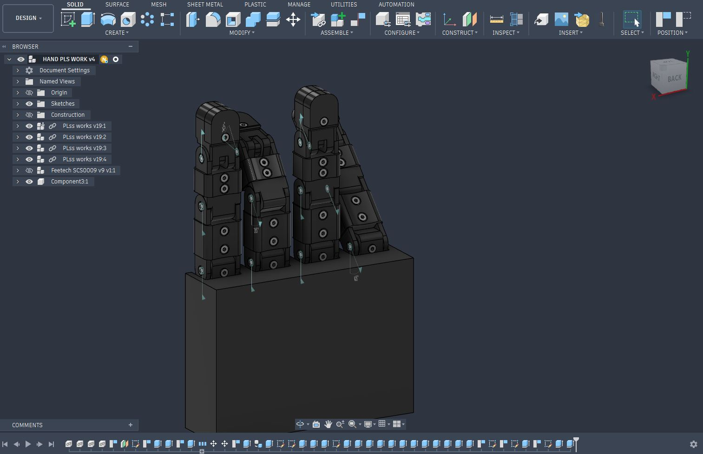
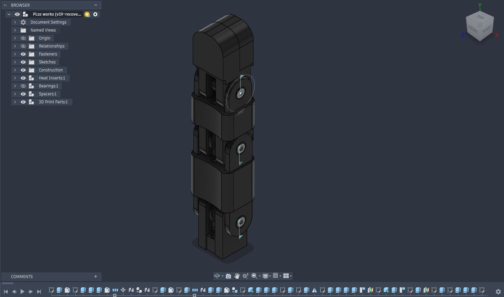
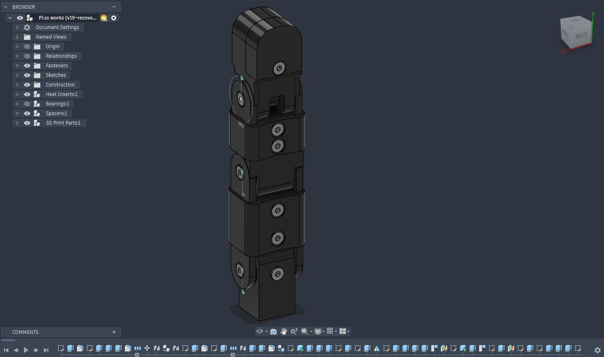

# Dexterous Hand
- To achieve and maintain the performance of precision with my own design. Soon will be published for opensource BUT right now it is still in progress.
- My previous progression are not being recorded in here
---

## Project Overview

- **Cost-Effective:** Designed to significantly lower production costs while maintaining functionality.
- **Joint Precision:** Applies precise control to each individual joint.
- **Custom Architecture:** Built completely from initial sketches rather than modifying any open-source models.
- **Actuation Mechanism:** Tendon-driven system utilizing **2-way routing**.

## ⚠️ Archived / Old Experimental Design

> 💡 **Note:** Newer versions of the project have deprecated this specific design.

| Front View | Back View |
| :---: | :---: |
|  |  |
|  |  |
