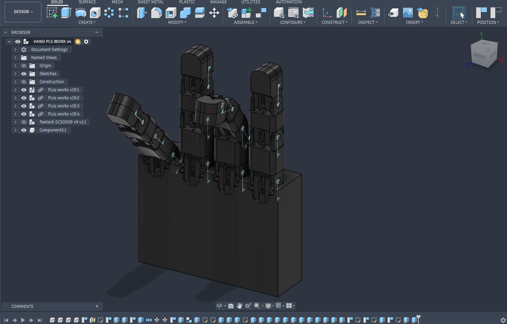

# 🦾 Dexterous Hand

A cost-effective, custom-designed dexterous robotic hand featuring individual joint precision, built entirely from scratch without modifying any existing open-source models.

---

## 🎯 Project Overview

- **Cost-Effective:** Designed to significantly lower production costs while maintaining functionality.
- **Joint Precision:** Applies precise control to each individual joint.
- **Custom Architecture:** Built completely from initial sketches rather than adapting open-source models.
- **Actuation Mechanism:** Tendon-driven system utilizing **2-way routing**.

## 🧪 Prototyping & Development

- Designed and tested a basic single-finger prototype to understand mechanism kinematics and behavior.
- Transitioning away from initial experimental iterations toward an improved, refined architecture.

---

## ⚠️ Archived / Old Experimental Design

> 💡 **Note:** Newer versions of the project have deprecated this specific design.

| Front View | Back View |
| :---: | :---: |
|  |  |
